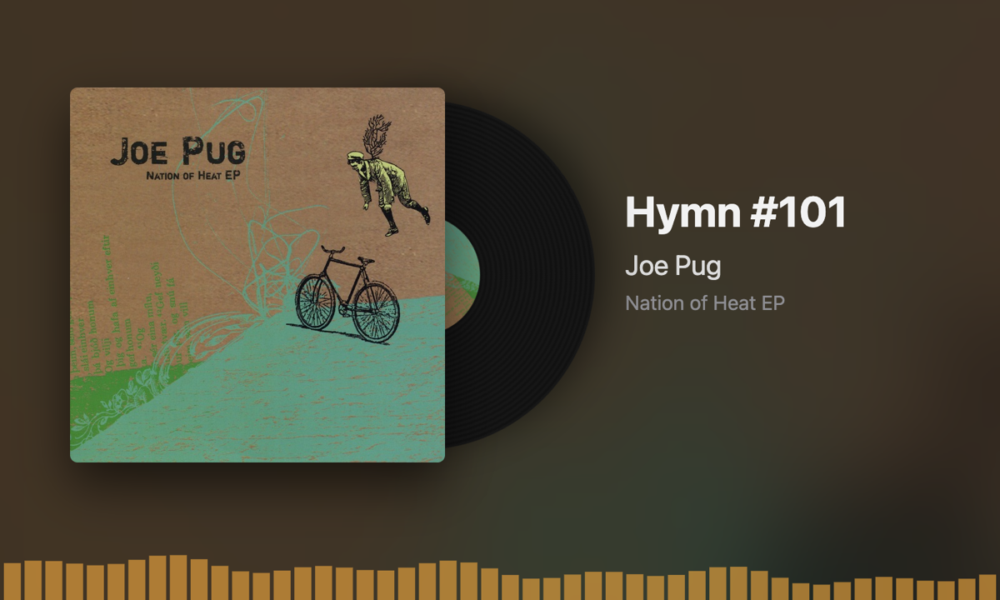
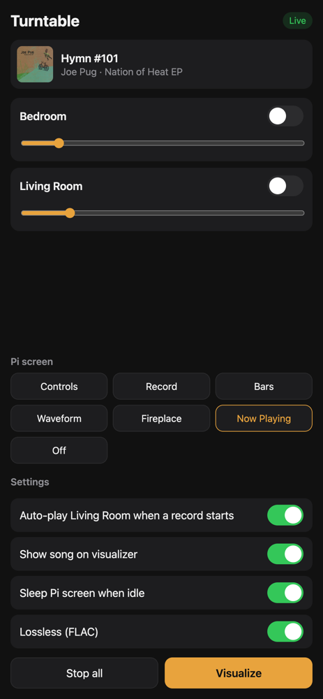
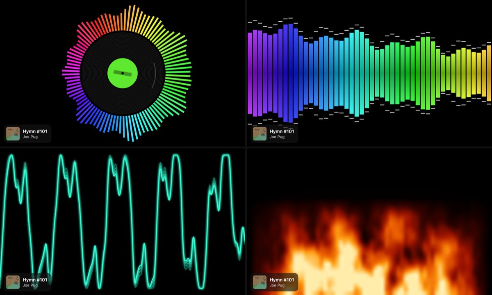

# Turntable

Play a record and hear it on your Sonos speakers. A Raspberry Pi records the turntable over USB, streams it to Sonos (lossless if you like), works out which song is playing, and shows it on a touchscreen and on your phone.



## What it does

- **Drop the needle and it plays.** When music starts, the chosen rooms (Living Room by default) start by themselves. They stop after five minutes of silence. A needle left clicking in the run-out groove counts as silence.
- **Every Sonos room, from your phone.** Rooms are found on the network automatically. Switch any of them on or off and set its volume at `http://turntable.local`. Add the page to your home screen and it opens like an app.
- **Knows the song.** Each track is identified with Shazam a few seconds after it starts, using the gap between tracks, the song's known length from the album track list, and a regular re-check. Title, artist, album and cover appear on the phone and the Pi's screen. Last.fm scrobbling is supported for whoever says they're listening.
- **Visualizers.** Now Playing (above), a spinning record, spectrum bars, a waveform, and a fireplace, all driven by the music and timed to match the delay on the speakers. They work on the Pi's touchscreen and on your phone. You can choose what the Pi shows, or switch its screen off, from your phone. The screen sleeps when the music stops.
- **Lossless or MP3.** 320 kbps MP3 by default; a switch moves to FLAC, including rooms that are already playing.
- **Works without internet.** Playback needs only your home Wi-Fi. Song info, cover art and Last.fm come back when the internet does.

| Phone | Visualizers |
|---|---|
|  |  |

## How it works

Two services, so the app can be updated without interrupting what's playing:

```
                    ┌─ audio.py (turntable-audio) ────────────────────────────┐
turntable ──USB──▶  │ ffmpeg ──MP3──▶ Icecast :8000/turntable.mp3 ──▶ Sonos     │
                    │   └─PCM─┬─▶ FLAC :8001/turntable.flac ─────────▶ Sonos     │
                    │         └─▶ :8001/pcm (local) ─┐                          │
                    └────────────────────────────────┼──────────────────────────┘
                    ┌─ server.py (turntable) ─────────▼──────────────────────────┐
                    │ level detection → auto-play, screen sleep, track gaps      │
                    │ Shazam + iTunes track list → now playing, Last.fm          │
                    │ spectrum → WebSocket → visualizers                         │
                    │ control page + API on :80, Sonos via SoCo                  │
                    └────────────────────────────────────────────────────────────┘
```

- **`audio.py`** records the turntable and serves the streams. It rarely changes. Each lossless listener gets its own encoder when it connects, because Sonos plays silence if it joins a FLAC stream that's already been running a while.
- **`server.py`** does everything else, and restarting it doesn't touch playback. If the audio service ever restarts, the rooms that were playing are put back automatically.
- **`static/`** is the control page and visualizers. Changes there go live without restarting anything.
- **`lastfm.py`** handles scrobbling: each person links their own Last.fm account, and someone picks who's listening on their phone. Nobody is picked by default, so nothing scrobbles by accident, and the choice expires after five minutes without music.

## Hardware

- Raspberry Pi 3 or newer, with a 5V 2.5A (or better) supply. An undersized supply causes slowdowns, Wi-Fi drops and the odd audio blip.
- A turntable with a USB output, or any USB audio interface.
- Optional: the official 7" touchscreen.
- Sonos speakers on the same network.

## Setup

1. Flash **Raspberry Pi OS (64-bit)** with Raspberry Pi Imager. Set the hostname to `turntable` and the user to `pi`, and enable SSH with your public key.
2. Plug the turntable into the Pi over USB.
3. From this repo on your computer:

   ```sh
   deploy/push.sh pi@turntable.local --audio   # first install; later just deploy/push.sh
   ```

   This installs Icecast, ffmpeg, SoCo and ShazamIO, generates the Icecast passwords, sets up both services, and opens the control page full-screen on the Pi's display.
4. Open **http://turntable.local** on your phone.

`deploy/push.sh` restarts only the control app, so the music keeps playing. If `audio.py` changed, it stops and asks for `--audio`, because restarting the audio service interrupts playback for a few seconds.

## Configuration

`/etc/turntable.env` on the Pi (created by the installer):

| Variable | Default | |
|---|---|---|
| `GAIN_DB` | `0` | Input boost in dB |
| `VISUAL_DELAY` | `2.5` | Seconds to delay the visuals so they match Sonos |
| `ALSA_DEVICE` | `hw:CODEC` | Capture device (`arecord -l` lists them) |
| `LASTFM_API_KEY`, `LASTFM_API_SECRET` | | Optional. From a [Last.fm API account](https://www.last.fm/api/account/create); enables scrobbling. |

The switches on the control page are saved to `~/.config/turntable/settings.json`. That file also holds `auto_rooms` (which rooms auto-play) and `idle_minutes` (how long silence lasts before rooms stop and the screen sleeps).

After editing either file, restart: `sudo systemctl restart turntable`.

## Screen orientation

If the touchscreen is mounted upside down, add this to `~/.config/kanshi/config` on the Pi:

```
profile {
	output DSI-1 enable mode 800x480 position 0,0 transform 180
}
```

On a Pi 3 the desktop flips the screen in software, which costs about one CPU core whenever the screen is animating. The Pi's screen is therefore capped at 12 frames a second. Phones aren't affected.

## Troubleshooting

- **A room shows as playing but is silent.** Turn it off and on from the control page. If it stays silent, switch Lossless off to rule out the FLAC stream.
- **The song card says "Couldn't identify this song".** Shazam doesn't know that recording. Smaller releases are sometimes missing.
- **Logs:** `journalctl -u turntable` (rooms, song changes, gaps) and `journalctl -u turntable-audio` (capture).
- **Power:** `vcgencmd get_throttled` shows `0x50005` while the supply can't keep up.

## Thanks

[SoCo](https://github.com/SoCo/SoCo) for Sonos control, [ShazamIO](https://github.com/shazamio/ShazamIO) for song recognition, Apple's iTunes lookup for track lists, and [peinador/fireplace](https://github.com/peinador/fireplace) for the fireplace technique. The album art in the screenshots belongs to its owners.
